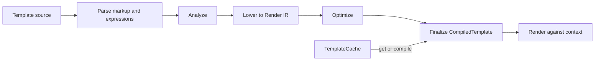

# Zeft architecture

This directory defines the normative architecture of Zeft, a runtime-first Zig
template engine with optional comptime compilation. Requirements using
**MUST**, **MUST NOT**, **SHOULD**, and **MAY** are normative.

Zeft MUST compile each template source into an immutable `CompiledTemplate`.
Rendering MUST execute that compiled representation against a context and a
writer. Applications SHOULD compile a template once and reuse it for each
render. Compilation MUST NOT consult a process-global cache.

The compiler MUST parse markup as structured HTML or XML, including elements,
attributes, attribute values, text, and template expressions. It MUST lower
that structure into a linear Render IR and optimize the IR before finalizing
the compiled template. Rendering MUST NOT parse markup or template syntax.

The documents in this directory define the details:

- [Compilation](compilation.md): parsing, analysis, lowering, optimization,
  diagnostics, and compilation options.
- [Runtime](runtime.md): compiled templates, Render IR, expression evaluation,
  rendering state, escaping, and errors.
- [Caching and ownership](caching-and-ownership.md): cache boundaries,
  invalidation, includes, lifetimes, and comptime compilation.

## Architectural invariants

1. The AST is temporary compiler data. The optimized Render IR is the
   persistent executable representation.
2. Anything determined during compilation MUST be represented in the compiled
   template and MUST NOT be rediscovered by parsing during rendering.
3. A compiled template MUST be immutable after finalization. Mutable execution
   state MUST belong to an individual render.
4. `compile()` MUST be deterministic for the same source, options, and compiler
   version.
5. The cache MUST be an explicit application-owned layer around compilation.
6. Runtime and comptime compilation MUST produce the same Render IR
   contract consumed by the renderer.
