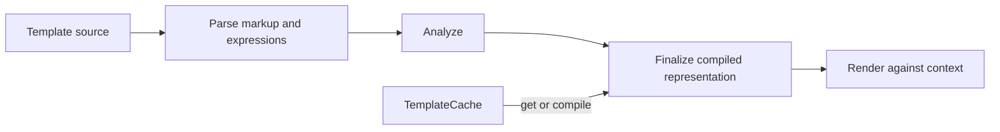

# Zeft architecture

This directory defines the normative architecture of Zeft, a Zig markup
template engine with runtime compilation and optional comptime compilation.
Requirements using **MUST**, **MUST NOT**, **SHOULD**, and **MAY** are
normative.

Zeft compiles template source into an immutable `CompiledTemplate`, then
renders it against application data and a writer. Applications SHOULD compile
a template once and reuse it. Compilation MUST NOT consult a process-global
cache, filesystem, or include resolver as an implicit side effect.

The documents in this directory define the details:

- [Template language](language.md): markup, syntax, expressions, values,
  escaping, and whitespace.
- [Public API](public-api.md): results, ownership, native values, callbacks,
  resolvers, diagnostics, and concurrency.
- [Compilation](compilation.md): compiler boundaries and required output.
- [Runtime](runtime.md): execution invariants and render state.
- [Caching and ownership](caching-and-ownership.md): cache boundaries,
  invalidation, includes, and retained lifetimes.

The non-normative [implementation internals](../design/internals.md) describe
how the current code satisfies these contracts.

## Architectural invariants

1. Rendering MUST execute a prepared representation and MUST NOT parse template
   source, markup, or expressions.
2. Anything determined during compilation MUST be represented in the compiled
   template.
3. A compiled template MUST be immutable after compilation. Mutable execution
   state MUST belong to an individual render.
4. `compile()` MUST be deterministic for the same source, options, and compiler
   version.
5. The cache MUST be an explicit application-owned layer around compilation.
6. Runtime and comptime compilation MUST produce the same logical compiled
   contract consumed by the renderer; its physical representation is not a
   public ABI.
