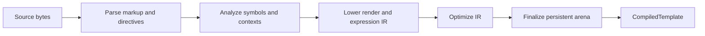

# Implementation internals

This document describes the current Zeft implementation. It is non-normative:
the code may change without an architecture change as long as it continues to
satisfy `docs/architecture/`. Update this document when the implementation
structure or major data flow changes.

## Module map

| Module | Current responsibility |
| --- | --- |
| `src/core.zig` | Shared options, source spans, and diagnostic categories |
| `src/compiler/parser.zig` | Format-aware parser and temporary AST |
| `src/compiler/expression.zig` | Expression tokenization and precedence parsing |
| `src/compiler/analysis.zig` | Root symbols, lexical bindings, and output-context analysis |
| `src/compiler/ir.zig` | Render IR and expression IR data structures |
| `src/compiler/lower.zig` | AST and analyzed expressions to executable IR |
| `src/compiler/optimize.zig` | Expression folding and render-program rewrites |
| `src/runtime.zig` | Native value adapters, expression VM, render VM, escaping, and built-ins |
| `src/zeft.zig` | Public API, compilation orchestration, finalization, cache, and includes |

`build.zig` exposes each internal component as a Zig module and assembles the
public `zeft` module. The installed static library uses `src/zeft.zig` as its
root module.

## Python package

`bindings/python/` is a standalone `uv` project with a `src/zeft/` package
and a Hatchling build backend. Wheel builds use a Hatch hook to invoke the
root Zig `python-extension` step with the active CPython include directory.
The source distribution carries the Zig build inputs under `engine/` so a
wheel can be built from the sdist without access to the engine checkout.
The GitHub Actions wheel matrix selects an explicit Zig target and a matching
runner for Linux x86_64/aarch64, macOS x86_64/arm64, and Windows x86_64, with
CPython 3.11 through 3.14. Each job installs and imports its wheel.
The C shim initializes `zeft._native`, whose `Template` object releases its
opaque Zig compiled-template owner when finalized. The Zig bridge compiles
UTF-8 source with selected compile options and renders through the engine's
runtime API. The C shim converts mappings, scalar values, lists, and tuples to
a temporary recursive tree for each synchronous render. That tree and the
Python context remain live until rendering returns. Compile and render
diagnostics cross the boundary as a kind and optional byte span; the Python
package adapts them to `CompileError` and `RenderError`. The `Template` wrapper
releases its native owner on `close()`, context manager exit, or finalization.
The target API and lifetime contract are in
`docs/architecture/python.md`. The Zig package build remains independent of
Python and `uv`.

## Compilation flow

`zeft.compile` owns a temporary arena for all intermediate data and runs this
pipeline:

Parsing produces a temporary document tree containing text, serialized static
markup, elements, attributes, interpolations, conditionals, loops, loop
control, and includes. Expression source spans are parsed separately into
expression trees during analysis, then lowered into expression IR. Block tokens
use `{#`, `{:`, and `{/` prefixes; standalone directives use ``.
Else-if chains are represented as conditionals nested in the preceding else
body. Loops carry separate iteration and empty-sequence bodies. Analysis and
lowering process the empty-sequence body after leaving the iteration binding.
The loop-entry empty target reaches that body; normal exhaustion and loop
controls bypass it.

Analysis assigns root symbol IDs in first-occurrence order, resolves known loop
bindings to local slots, and records whether interpolations occur in text or an
attribute. Lowering serializes markup and whitespace policy output, appends
static byte strings, and creates render and expression instruction streams.

The temporary arena is destroyed when `compile` returns. A successful result
first copies all persistent data into a separate arena owned by the compiled
template.

## Current intermediate representations

Render IR is a linear instruction slice. Its variants currently write static
bytes or expressions, branch, jump, enter and advance loops, break or continue,
include another identity, and end execution. Static bytes and include identities
are addressed through a string table; expressions use an expression table;
root names use a symbol table. Every instruction carries a source span.

Expression IR is stack based. It can load a root symbol or local slot, push a
literal, select properties or indexes, apply unary and binary operators,
short-circuit through jumps, invoke functions and filters, and return a value.
Expression instructions also carry source spans.

The IR types live in `src/compiler/ir.zig`. They are private implementation
formats and have no stable serialized or public ABI.

## Optimization and finalization

The optimizer currently:

- folds constant expression operations while retaining operator spans;
- merges adjacent static writes and removes empty writes;
- simplifies constant branches and removes unreachable instructions;
- remaps and validates every control-flow destination after rewriting;
- threads destinations through unconditional jumps.

Finalization creates a persistent arena, copies instructions and metadata, and
interns repeated string payloads used by static output, symbols, string
literals, property names, callback names, and include identities. It also owns
a copy of the pretty-indentation option. `CompiledTemplate.deinit` releases the
persistent arena and its outer bookkeeping allocations.

## Rendering

The render VM in `src/runtime.zig` walks linear Render IR with a program
counter. Static instructions write table bytes directly. Expression writes run
the expression VM and then escape or format the returned scalar. Branch and
loop instructions change the program counter using their compiled targets.

Each render creates a scratch arena from `RenderOptions.allocator`. Local
bindings and loop frames are allocated from that arena with capacity based on
the render instruction count. The arena is destroyed on every return path.
Expression evaluation uses a fixed 256-value stack.

The runtime value union currently contains null, `bool`, `f64`, borrowed byte
strings, callback-backed objects, and callback-backed sequences. Native
adaptation supports booleans, byte strings, structs, arrays, and slices.
Aggregate nested values require the root context to be passed by pointer so
their borrowed storage remains stable. Numeric and optional native fields are
not implemented yet.

Root context structs are converted at the public boundary into a stack array of
name/value entries. Objects and sequences retain an opaque pointer plus a
comptime-generated lookup callback. Property lookup scans names
case-sensitively; root lookup scans the context entry slice.

Functions and filters are resolved from per-render registrations before the
built-ins. Pipe calls try filters before functions. Callback errors currently
become `filter_failure` or `function_failure` diagnostics and do not retain the
original Zig error name. Callback result bytes may use the render scratch arena.

## Escaping and output

Lowering assigns either text or attribute escape context to every expression
write. Rendering combines that context with the compiled HTML/XML format.
Strings and booleans pass through the escaper; signed integers and `f64`
numbers are printed directly; null writes nothing; sequences and objects fail
direct interpolation.

Output is streamed to the caller's `std.Io.Writer`. A later failure does not
roll back bytes already written. Writer errors propagate as Zig errors.

## Cache and includes

`TemplateCache` stores owned identity, source, options, compiled template, and
reference count for each version. A spin mutex protects lookup, publication,
replacement, eviction, failure records, and reference accounting. Compilation
currently occurs while that mutex is held; rendering does not.

The cache key first uses a Wyhash fingerprint containing the compiler/IR
version marker, identity, source, format, whitespace policy, and indentation.
Exact identity, source, and option equality confirms a hit. Successful reload
retires the prior version. Failed reload records its diagnostic and preserves
the last valid entry.

`TemplateLease` increments an entry reference count. A retired or evicted entry
is destroyed only when its count reaches zero. Cache deinitialization asserts
that no entry is still leased.

Cache rendering installs private include callback fields in `RenderOptions`.
The callback acquires the current child entry for each include, tracks active
identities in a render-local dependency stack, detects cycles, and releases the
child after its render. Include diagnostic identity bytes are copied into a
cache-owned diagnostic arena so they survive replacement or eviction. The
public resolver abstraction described by the architecture is not implemented
yet.

## Verification layout

Focused module and unit tests cover parser structure, IR invariants,
optimization, allocation failure, cache ownership, and concurrency. Public
end-to-end suites are imported through `tests/integration.zig`:

- `tests/e2e_markup.zig`
- `tests/e2e_expressions.zig`
- `tests/e2e_control_flow.zig`
- `tests/e2e_whitespace.zig`
- `tests/e2e_diagnostics.zig`
- `tests/e2e_cache.zig`
- `tests/e2e_lifecycle.zig`

Reusable sources and exact outputs live under `tests/fixtures/`; their coverage
inventory is `tests/fixtures/catalog.md`. `bench/main.zig` provides the
standalone compile/render benchmark described in
`docs/design/benchmark-results.md`.
